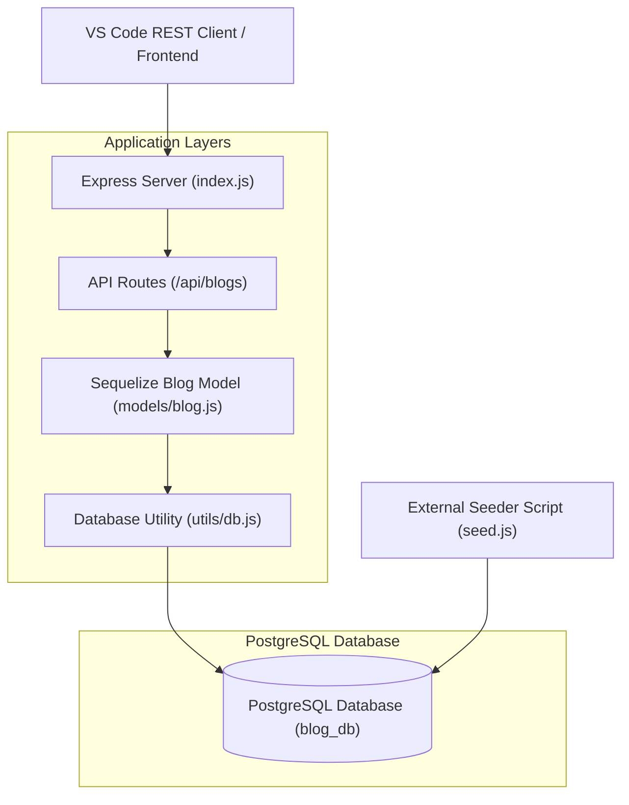
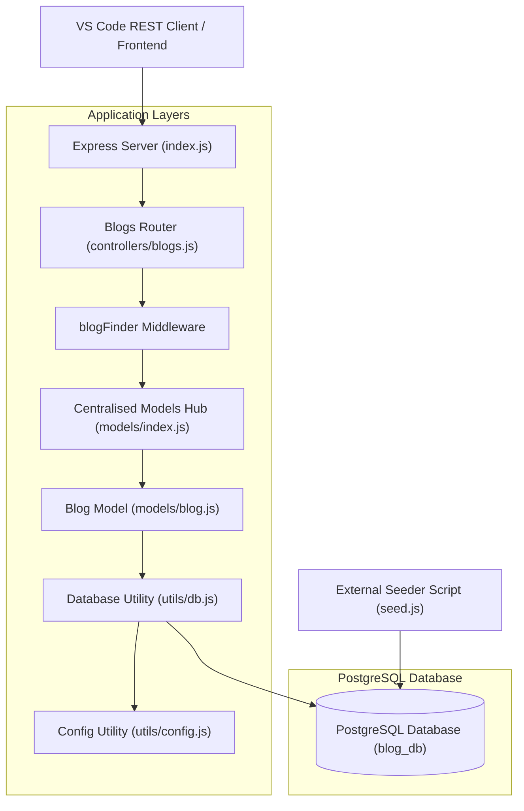
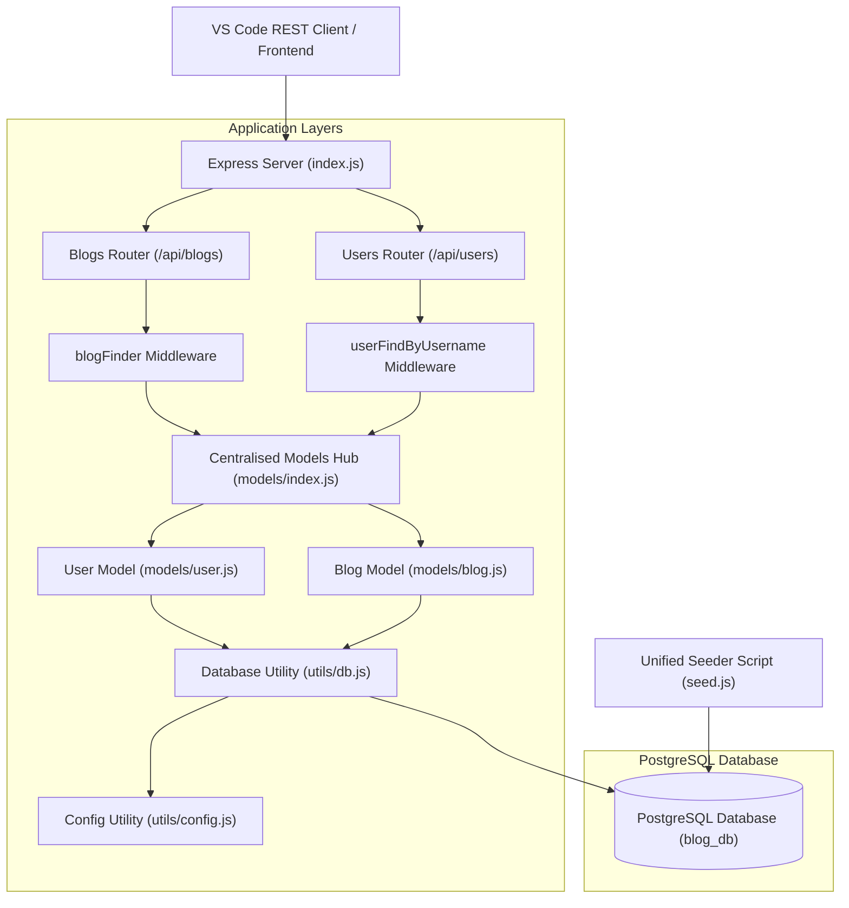
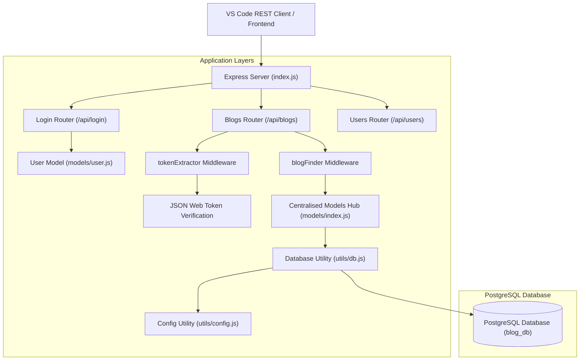
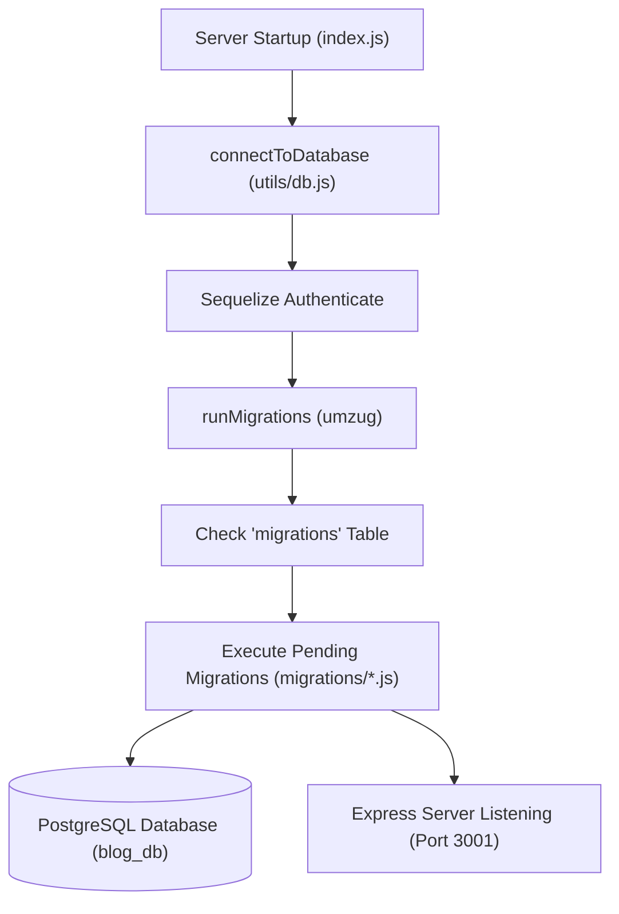

# FullStackOpen-Part-13 

## Blog List Backend Exercise-4

This repository contains a Node.js, Express, and Sequelize backend for a blog service application. The service includes database connection management, automated data seeding, RESTful API development (`GET`, `POST`, `DELETE`), input validation handling, and a local testing workflow using VSCode's RESTClient.

### Architectural Overview & Modular Design

The application follows a modular design pattern to ensure separation of concerns, readability, and maintainability:



The project is organised into structured directories and files:

- `requests.rest`: A modular script configured with file variables for testing API endpoints directly inside VS Code.
- `index.js`: The main entry point initialising the Express application, middleware (`express.json()`), route handlers, and asynchronous startup sequence.
- `models/blog.js`: Defines the Sequelize Blog schema mapping directly to the PostgreSQL table (`id`, `author`, `url`, `title`, `likes`).
- `utils/db.js`: Encapsulates the Sequelize instance and database connection logic.
- `seed.js`: An independent automation script (logic) used to populate the database with initial records.
- `utils/seedingBlogData.js`: Seeding data used to initially populate (seed) the database Blogs table.

### Core API Endpoints

| Method | Endpoint | Description |
| :--- | :--- | :--- |
| **GET** | `/api/blogs` | Retrieves all blog objects stored in the database. |
| **POST** | `/api/blogs` | Creates a new blog entry (validates payload, returns `201 Created` or `400 Bad Request`). |
| **DELETE** | `/api/blogs/:id` | Removes a specific blog by its primary key ID (`204 No Content` or `404 Not Found`). |

### Quick Start Guide

#### Prerequisites

- Node.js (v18+) installed.
- PostgreSQL running locally.
- VS Code with the REST Client extension.

#### Running and Managing the Backend

**Install dependencies:**

   ```bash
   npm install
   ```

**Seed the database (Populate initial data):**

   ```bash
   npm run seed
   ```

**Start the application:**

   ```bash
   npm start
   ```

**Testing the Endpoints:**

   Open the `requests.rest` file in VS Code and click **Send Request** above any of the defined blocks to interact with our running API (`http://localhost:3001/api/blogs`).

- **Note:** I thought I had done a good job with Exercise 4, going above and beyond to create a robust structure with clean, efficient, readable and maintainable code. However, Chapter 3 challenged that assumption and made me realise there was considerable room for improvement. Consequently, the README needs to be rewritten to reflect the improved structure, design and coding practices.

---


## Blog List Backend Exercise-5

This repository contains a Node.js, Express, and Sequelize backend for a blog service application, refactored into a professional, modular **MVC (Model-View-Controller)** architecture. The service includes centralised configuration, database connection management, automated data seeding, custom middleware, robust error handling, and a local testing workflow using VS Code's REST Client.

### Architectural Overview & Modular Design

The application follows a clean modular design pattern to ensure strict separation of concerns, scalability, and maintainability:



The project is organised into structured directories and files:

- `requests.rest`: A modular script configured for testing API endpoints (including success, validation failures, 404s, and malformed IDs) directly inside VS Code.
- `index.js`: The main application entry point initialising Express, mounting middleware (`express.json()`), connecting routers, and managing the asynchronous startup sequence.
- `utils/config.js`: Centralises environment variables (such as `PORT` and `DATABASE_URL`).
- `utils/db.js`: Encapsulates the Sequelize instance and database connection logic with explicit authentication.
- `models/blog.js`: Defines the Sequelize Blog schema mapping directly to the PostgreSQL table (`id`, `author`, `url`, `title`, `likes`).
- `models/index.js`: Centralised export portal for all database models.
- `controllers/blogs.js`: Houses route handlers (`GET`, `POST`, `DELETE`) and the custom `blogFinder` middleware for encapsulating resource lookups and error handling.
- `seed.js`: An independent automation script used to reset, drop, and populate the database with initial records.
- `utils/seedingBlogData.js`: Seeding data payload used to initially populate the blogs table.

### Core API Endpoints & Middleware

| Method | Endpoint | Description |
| :--- | :--- | :--- |
| **GET** | `/api/blogs` | Retrieves all blog objects stored in the database. |
| **POST** | `/api/blogs` | Creates a new blog entry (validates payload, returns `201 Created` or `400 Bad Request`). |
| **DELETE** | `/api/blogs/:id` | Uses `blogFinder` middleware to look up the resource, removes it by primary key ID (`204 No Content`, `404 Not Found`, or `400 Malformed ID`). |

### Quick Start Guide

#### Prerequisites

- Node.js (v18+) installed.
- PostgreSQL running locally.
- VS Code with the REST Client extension.

#### Running and Managing the Backend

**Install dependencies:**

```bash
npm install
```

**Seed the database (Populate initial data):**

```bash
npm run seed
```

**Start the application:**

```bash
npm start
```

**Testing the Endpoints:**

Open the `requests.rest` file in VS Code and click **Send Request** above any of the defined blocks to test success paths, missing fields, non-existent 404 items, and malformed IDs against our running API (`http://localhost:3001/api/blogs`).

## Blog List Backend Exercise-6

That was easy! For a PUT /api/blogs/:id request, the main challenge is to correctly identify the required blog by its id. In that respect, the Blog.findByPk middleware function can do all the heavey lifting for us.

The `blogFinder` already handles:

- Looking up the blog by its ID (`Blog.findByPk`)

- Catching malformed IDs (sending a 400 error)

- Catching missing blogs (sending a 404 error)

- Attaching the found blog to `req.blog`

See the new `PUT` route in `controllers/blogs.js` and the new `PUT` test script in `requests.rest`.


## Blog List Backend Exercise-7

In Exercise-6 our route handlers (like `POST` and `PUT`) used individual `try/catch` blocks to catch database errors and send a `400` response.

Exercise-7 calls for centralised error handling, where we:

- Remove the repetitive `try/catch` blocks from the controllers.

- Pass any errors down to Express automatically using `next(error)`.

- Create a single, dedicated error-handling middleware function at the very end of our application pipeline that catches these errors and decides how to respond to the client.

Files updated:
- **`utils/middleware.js`**: Created the 4-argument `errorHandler` function.

- **`index.js`**: Registered the error handler at the end of the middleware pipeline.

- **`controllers/blogs.js`**: Removed `try/catch` blocks and passed errors via `next(error)`.

---

## Blog List Backend Exercise-8

The repository has been extended to implement a full user management subsystem for the blog service. Exercise-8 introduces a dedicated `User` model, modular user routing (`controllers/users.js`), custom middleware for lookup by unique username, robust password field handling, and local `404` fallback handling for missing records. I added a unified data seeding script, seeding data for users and blogs, and a `requests.rest` REST Client test file.

### Architectural Overview & Modular Design

The application maintains strict modularity, separating user logic from blog logic while leveraging centralised configuration, error handling, and database connection utilities:



The project structure now includes:
- `models/user.js`: Defines the Sequelize User schema mapping to the PostgreSQL `users` table (`id`, `username` [unique, non-nullable], `name` [non-nullable], with Sequelize-managed timestamps via `underscored: true`).
- `controllers/users.js`: Houses route handlers (`GET` all, `POST`, `GET` by ID, `PUT` by username) and the custom `userFindByUsername` middleware.
- `utils/seedingUserData.js`: Seeding data payload for initial users.
- `seed.js`: Updated unified automation script that drops, resets, and seeds both users and blogs sequentially.

### Core User API Endpoints & Middleware

| Method | Endpoint | Description |
| :--- | :--- | :--- |
| **GET** | `/api/users` | Retrieves all user objects stored in the database. |
| **POST** | `/api/users` | Creates a new user entry (validates payload, safely ignores unexpected fields like `password`, returns `201 Created` or `400 Bad Request`). |
| **GET** | `/api/users/:id` | Retrieves a single user by primary key ID (manages missing records locally, returns user or `404 Not Found`). |
| **PUT** | `/api/users/:username` | Uses `userFindByUsername` middleware to look up the user by unique username, updates their name, and saves the instance (`200 OK` or `404 Not Found`). |

### Key Implementation Details

- **Custom Username Middleware (`userFindByUsername`)**: Encapsulates `User.findOne({ where: { username: req.params.username } })` for `PUT` requests, attaching the found user instance to `req.user` or cleanly responding with a `404 Not Found` if no match is found.
- **Password Payload Handling**: Satisfies criteria by accepting requests containing a `password` field during user creation without failing, safely ignoring fields not defined in the Sequelize model schema.
- **Local `404` Fallback**: Recognises that `user == null` lookups in Sequelize represent empty result sets rather than database exceptions, handling them locally as standard `404` errors rather than triggering the centralised error-handling pipeline.
- **Unified Seeding**: Combines user and blog creation into a single sequential script (`seed.js`) to ensure clean state resetting across all database entities.


---

## Blog List Backend Exercise-9

In Exercise-9, we enhanced data validation and API error reporting by implementing built-in email validation on the user model and upgrading our centralised error-handling middleware.

### Key Implementations & Enhancements

* **Model-Level Email Validation (`models/user.js`)**:
  * Configured the `username` field to enforce that values must be valid email addresses using Sequelize's built-in `isEmail` validator.
  * Supplied a custom error message (`"username must be a valid email address"`) to ensure descriptive feedback when validation fails.

* **Upgraded Centralised Error Handling (`utils/middleware.js`)**:
  * Updated the global `errorHandler` middleware to explicitly check for `SequelizeValidationError` instances.
  * Extracted individual validation error messages into an array using `.map()` and returned them in the required structured JSON format (`{ error: ["..."] }`).

### Files Updated
- **`models/user.js`**: Added the `validate` property with the `isEmail` rule and custom error message to the `username` attribute.
- **`utils/middleware.js`**: Added conditional logic to handle `SequelizeValidationError`, mapping errors into a clean array format with an HTTP `400 Bad Request` status code.


## Blog List Backend Exercise-10

The repository has been extended to implement user authentication via JSON Web Tokens (JWT), password verification using `bcrypt`, a dedicated login endpoint (`POST /api/login`), centralised token extraction middleware (`tokenExtractor`), and token-authenticated blog creation (`POST /api/blogs`) linked directly to the user.

### Architectural Overview & Modular Design

The application maintains modularity, separating authentication logic from blog and user management while leveraging centralised configuration, token extraction, model synchronisation, and error handling:



The project structure has been expanded with:
- `utils/authMiddleware.js`: Houses the `tokenExtractor` middleware, which parses incoming `Authorization` headers, strips the `Bearer ` prefix, verifies the cryptographic signature using `jsonwebtoken`, attaches the decoded payload to `req.decodedToken`, and handles missing or invalid tokens with HTTP `401 Unauthorised` responses.
- `controllers/login.js`: Handles user authentication by looking up the user, verifying their password hash using `bcrypt`, and issuing a signed JWT containing their username and database ID.
- `controllers/blogs.js`: Updated to protect the `POST` route with `tokenExtractor`, automatically fetching the user via `User.findByPk` and linking newly created blogs to the authenticated user via foreign keys (`userId`).
- `models/index.js` & `index.js`: Refactored to utilize a modular `syncModels` asynchronous function incorporating Sequelize's `{ alter: true }` lifecycle option during server startup.

### Core Authentication & Blog Creation Endpoints

| Method | Endpoint | Description |
| :--- | :--- | :--- |
| **POST** | `/api/login` | Authenticates user credentials (`username` and `password`), validates password hash, and returns a signed JWT token along with user details (`200 OK` or `401 Unauthorized`). |
| **GET** | `/api/blogs` | Public endpoint retrieving all blog objects stored in the database. |
| **POST** | `/api/blogs` | Protected by `tokenExtractor`. Creates a new blog entry linked to the authenticated user (`201 Created`, `401 Unauthorized`, or `400 Bad Request`). |

### Key Implementation Details

- **Token Extraction (`tokenExtractor`)**: Safely parses incoming `Authorization: Bearer <token>` headers, validating structural integrity while cleanly logging technical errors to the terminal and returning predictable `401` statuses to clients.
- **Secure Password Comparison**: Uses `bcrypt` to securely compare plaintext passwords against database-stored password hashes during login.
- **User Association**: Links each newly created blog to its creator in PostgreSQL via the `userId` foreign key derived from the verified JWT payload.
- **Model Synchronisation (`syncModels`)**: Utilises Sequelize's `sync({ alter: true })` lifecycle hook wrapped in a startup function during server boot to safely align database schemas with updated model definitions.

### Test

Test using the new requestsAuth.rest file which now accommodates authentication through the JWT bearer token.


## Blog List Backend Exercise-11

The repository has been extended to implement ownership-based authorisation for blog post deletion, ensuring that only the user who originally created a blog (the owner) can remove it from the system.

### Key Implementations & Enhancements

- **Ownership-Based Authorization (`controllers/blogs.js`)**:
  * Updated the `DELETE /api/blogs/:id` route to chain both `tokenExtractor` and `blogFinder` middleware.
  * Implemented a strict security check comparing the blog's `userId` foreign key (`req.blog.userId`) against the authenticated user's id extracted from the verified JWT token (`req.decodedToken.id`).
  * Enforced an HTTP **`403 Forbidden`** response with a descriptive error message (`"Unauthorized: Only the owner of a blog can delete it"`) if an unauthorized user attempts to delete a resource they do not own.

- **Automated Testing (`requestsAuth.rest`)**:
  * Expanded the VS Code REST Client test suite to include multi-user workflows.
  * Added test cases to verify that attempting to delete another user's blog correctly returns a `403 Forbidden` error, while successful ownership deletion return a `204 No Content` status.

### Files Updated
- **`controllers/blogs.js`**: Added the ownership guard clause checking `req.blog.userId === req.decodedToken.id` to the `DELETE` route handler.
- **`requestsAuth.rest`**: Added a second user creation, login token capture (`@otherAuthToken`), and failure testing for the `403 Forbidden` restriction.


## Blog List Backend Exercise-12

The repository has been extended to implement relational data fetching (eager loading) between the `User` and `Blog` models using Sequelize associations. Each blog record now automatically populates the user who added it, and each user record lists all the blogs they have published.

### Key Implementations & Enhancements

- **Relational Data Fetching (Eager Loading via `include`)**:
  - **`GET /api/blogs`**: Updated to include the associated `User` model, exposing safe, public details (`name`, `username`) while strictly excluding sensitive information like `passwordHash`.
  - **`GET /api/users` & `GET /api/users/:id`**: Updated to include associated `blogs`, using attribute exclusions (`attributes: { exclude: ['userId'] }`) to clean up the JSON payload by hiding redundant foreign keys inside nested blog objects.

- **Author vs. User Data Distinction**:
  - **`author` (String Attribute)**: A free-form text column on the `Blog` model used in earlier course exercises.
  - **`user` (Relational Foreign Key / Account)**: The system account (`userId`) linked via authentication tokens when the blog was created.
  - *Note on Data Discrepancy:* During early API testing, a single logged-in user account may display blogs associated with various independent author names (e.g., Dave Allen, John Smith). This is expected behavior reflecting the transition from manual string-based authors to database-level user relations.

### Files Updated
- **`controllers/blogs.js`**: Added the `include` option to `Blog.findAll()` to fetch joined user details with filtered attributes.
- **`controllers/users.js`**: Imported the `Blog` model and added the `include` option to user retrieval routes, ensuring password hashes are excluded from public API responses.
- **`models/index.js`**: The `include` clauses in users and blogs controllers work, because `models/index.js` already contains two key relationship definitions: `User.hasMany(Blog)` and `Blog.belongsTo(User)`.


## Blog List Backend Exercise-13

The repository has been extended to implement optional keyword filtering for the route returning all blogs (`GET /api/blogs`), allowing clients to filter blog records dynamically by title using query parameters.

### Key Implementations & Enhancements

- **Case-Insensitive Keyword Filtering (`controllers/blogs.js`)**:
  * Imported the Sequelize operators module (`const { Op } = require('sequelize')`).
  * Implemented optional keyword searching via the `search` query parameter (e.g., `GET /api/blogs?search=react`).
  * Utilise Sequelize's **`Op.iLike`** operator paired with wildcard percent signs (`%`) to ensure the search is completely case-insensitive and matches substrings anywhere within the blog's `title` field.

- **Query Optimization & Dynamic `where` Clause Construction**:
  * Adopted the advanced course pattern by initialising an empty `where` conditions object (`const where = {}`).
  * Conditionally populated `where.title` only when `req.query.search` is provided by the client.
  * Passed the dynamic `where` object into `Blog.findAll({ where })`, ensuring that standard requests without a search parameter do not generate unnecessary SQL `WHERE` clauses, preserving optimal database performance.

### Files Updated
- **`controllers/blogs.js`**: Added the `Op` import, initialised the dynamic `where` object, and configured `Op.iLike` substring matching for the `GET /api/blogs` route handler.

## Blog List Backend Exercise-14

The repository has been extended to enhance the keyword search capability on the `GET /api/blogs` endpoint, allowing clients to filter blogs where the search keyword appears in **either** the `title` field **or** the `author` field.

### Key Implementations & Enhancements

* **Multi-Field OR Searching (`controllers/blogs.js`)**:

  * Expanded the conditional `where` object inside the `GET /api/blogs` route handler using Sequelize's **`Op.or`** operator.

  * Supplied an array of query conditions targeting both the `title` and `author` columns (`where[Op.or] = [...]`).

  * Retained case-insensitive substring matching (`Op.iLike` with `%` wildcards) across both fields, ensuring queries like `GET /api/blogs?search=jami` return matching records regardless of whether the keyword matches the author's name or the blog's title.

  * Preserved query optimization so that standard `GET /api/blogs` requests without a `search` parameter continue to bypass unnecessary SQL `WHERE` clauses.

### Files Updated

* **`controllers/blogs.js`**: Updated the `req.query.search` conditional block in the `GET /api/blogs` route handler to evaluate an `Op.or` array across both `title` and `author`.


## Blog List Backend Exercise-15

The repository has been extended to implement result ordering on the `GET /api/blogs` endpoint, ensuring that retrieved blog records are automatically sorted by popularity (`likes`) in descending order.

### Key Implementations & Enhancements

* **Descending Result Ordering (`controllers/blogs.js`)**:

  * Updated the `Blog.findAll()` query options inside the `GET /api/blogs` route handler to include Sequelize's **`order`** property (`order: [['likes', 'DESC']]`).

  * Configured the nested sorting array so that PostgreSQL executes an `ORDER BY "blog"."likes" DESC` clause, returning the highest-liked blogs first.

  * Maintained seamless compatibility with existing query filters (`where`) and relational eager loading (`include`), ensuring both full blog lists and filtered keyword searches (`?search=...`) are consistently returned in descending order of likes.

### Files Updated

* **`controllers/blogs.js`**: Added the `order: [['likes', 'DESC']]` configuration option to `Blog.findAll()` within the `GET /api/blogs` route handler.


## Blog List Backend Exercise-16

The repository has been extended to implement an author statistics endpoint (`GET /api/authors`) that calculates the number of blogs and total likes for each author directly at the database level using advanced SQL aggregation functions.

### Key Implementations & Enhancements

* **Database-Level Aggregation (`controllers/authors.js`)**:

  * Created a dedicated modular controller and route at `/api/authors`.

  * Utilise Sequelize's `sequelize.fn('COUNT', sequelize.col('id'))` with an alias (`'blogs'`) to calculate the total number of blogs per author.

  * Utilise Sequelize's `sequelize.fn('SUM', sequelize.col('likes'))` with an alias (`'likes'`) to aggregate the total likes across an author's posts.

  * Apply `group: ['author']` to group rows by author name.

* **Database-Level Ordering**:

  * Enforce sorting on the aggregated results directly in the SQL query using `order: [[sequelize.fn('SUM', sequelize.col('likes')), 'DESC']]`. Thus, authors with the highest total likes appear at the top of the array.

* **Main Application Routing (`index.js`)**:

  * Import and mount the new `authorsRouter` under the `/api/authors` prefix.

### Core Author API Endpoints

| Method | Endpoint | Description |
| :--- | :--- | :--- |
| **GET** | `/api/authors` | Retrieves an aggregated list of authors showing their total blog count and sum of likes, ordered by likes descending (`200 OK`). |

### Files Created & Updated

* **`controllers/authors.js`**: Created new modular controller containing the `GET /` handler with `sequelize.fn`, `group`, and `order` database aggregations.
* **`index.js`**: Imported `authorsRouter` and mounted it on `/api/authors`.


## Blog List Backend Exercise-17

The repository has been extended to implement an automated end-to-end API testing suite and continuous integration (CI) pipeline via GitHub Actions. The application now supports isolated database switching between development (`blog_db`) and testing (`test_db`), cross-platform test execution using `cross-env`, and automated database resetting between test runs.

### Key Implementations & Enhancements

- **Environment-Based Database Switching (`utils/config.js` & `utils/db.js`)**:
  * Updated `utils/config.js` to dynamically select `TEST_DATABASE_URL` when `process.env.TESTING === 'true'`, defaulting to `DATABASE_URL` during normal operation.
  * Configured `utils/db.js` to connect to the dedicated PostgreSQL `test_db` database during test runs, ensuring automated tests remain completely isolated from development records.

- **Test Health Check & Database Reset Endpoints (`index.js`)**:
  * Added a root health check endpoint (`GET /`) used by the CI pipeline to verify that the Express server has booted and is ready to accept connections.
  * Implemented a conditional reset endpoint (`POST /api/reset`) that is mounted when `TESTING === 'true'`, truncating all database tables (`Blog` and `User`) with `restartIdentity` and `cascade` options before each test block.

- **Cross-Platform Test Scripts (`package.json`)**:
  * Installed `cross-env` and `axios` as development dependencies (`devDependencies`).
  * Configured `"start:test"` (`cross-env TESTING=true node index.js`) and `"test"` (`cross-env TESTING=true node --test --test-concurrency=1 tests/api_ch3.test.js`). The cross-env prefix ensures that the same commands always execute reliably across Windows, macOS, and Linux environments without OS-specific shell workarounds.
  * Enforced sequential test execution (`--test-concurrency=1`) to prevent race conditions during shared database state resets.

- **Automated CI/CD Pipeline (`.github/workflows/test.yml`)**:
  * Integrated the course test suite (`tests/api_ch3.test.js`) and GitHub Actions workflow (`API Tests`).
  * Automatically provisions an ephemeral PostgreSQL 17 service container (`test_db`), installs dependencies via `npm ci`, boots the server in test mode, and validates all 8 automated tests covering the Blogs, Users, and Authors APIs on every push or pull request to `main`.

### Test-Only & Health Check Endpoints

| Method | Endpoint | Description |
| :--- | :--- | :--- |
| **GET** | `/` | Health check endpoint returning a `200 OK` status confirming the server is active. |
| **POST** | `/api/reset` | Available only when `TESTING=true`. Truncates all database tables and resets primary key sequences to ensure clean test isolation (`204 No Content`). |

### Running the Automated Test Suite Locally

#### Prerequisites

- A dedicated PostgreSQL test database created locally (`psql -U postgres -c "CREATE DATABASE test_db;"`).
- `TEST_DATABASE_URL` configured in our `.env` file pointing to `test_db`.

#### Executing Tests

Two terminal instances are required to execute the test procedure:

1. **Terminal 1 — Start the backend server in test mode:**

   ```bash
   npm run start:test
   ```

2. **Terminal 2 — Run the automated test suite:**

   ```bash
   npm test
   ```

### Files Created & Updated

- **`utils/config.js`**: Added conditional logic to export `TEST_DATABASE_URL` when `TESTING === 'true'`.
- **`utils/db.js`**: Updated database connection initialisation to use the environment-aware database URI.
- **`index.js`**: Added the `GET /` health check route and the environment-guarded `POST /api/reset` truncation endpoint.
- **`package.json` & `package-lock.json`**: Added `cross-env` and `axios` dev dependencies along with the `"start:test"` and `"test"` npm scripts.
- **`tests/api_ch3.test.js`**: Added the automated Node native test runner suite verifying Blogs, Users, and Authors endpoints.
- **`.github/workflows/test.yml`**: Configured the GitHub Actions workflow for automated CI testing against a PostgreSQL 17 service container.


## Blog List Backend Exercise-18

The repository has been refactored to replace automatic model schema synchronisation (`sync()`) with version-controlled database migrations powered by `umzug`. Database table creation is now explicitly defined in migration scripts, ensuring predictable schema evolution and safe database initialisation upon server startup.

### Architectural Overview & Modular Design

The application startup pipeline now delegates schema creation and verification to `umzug` before accepting incoming HTTP requests:



### Key Implementations & Enhancements

- **Migration Runner Integration (`utils/db.js`)**:
  * Installed `umzug` to programmatically manage and execute database migrations during application startup.
  * Configured `runMigrations` with `SequelizeStorage` to track executed migrations inside a dedicated `migrations` table in PostgreSQL, resolving migration files from the root `migrations/` directory.
  * Exposed `rollbackMigration` alongside `connectToDatabase` to support programmatic migration rollbacks when needed.

- **Initial Database Schema Migration (`migrations/`)**:
  * Dropped all legacy tables (`blogs` and `users`) in PostgreSQL to ensure a clean migration baseline.
  * Created the initial migration script defining both the `users` and `blogs` tables, explicitly specifying primary keys, foreign key references (`user_id` referencing `users.id`), and required `created_at` and `updated_at` timestamp columns.

- **Removal of Automatic Schema Synchronisation (`models/index.js` & `index.js`)**:
  * Removed all `User.sync()`, `Blog.sync()`, and `sync({ alter: true })` calls from the codebase so that schema management is handled exclusively through versioned migrations without conflicts.

### Database Schema Initialised by Migration

| Table | Columns | Notes |
| :--- | :--- | :--- |
| **`users`** | `id`, `username`, `name`, `password_hash`, `created_at`, `updated_at` | `username` enforced as unique and non-nullable; timestamps managed explicitly in migration. |
| **`blogs`** | `id`, `author`, `url`, `title`, `likes`, `user_id`, `created_at`, `updated_at` | `user_id` configured as a foreign key referencing `users(id)`; default `likes` set to `0`. |
| **`migrations`** | `name` | Automatically created and maintained by `umzug` (`SequelizeStorage`) to log applied migration files. |

### Files Created & Updated

- **`package.json` & `package-lock.json`**: Installed `umzug` as a project dependency.
- **`utils/db.js`**: Implemented `runMigrations` and `rollbackMigration` using `Umzug` and `SequelizeStorage`, integrating migration execution into `connectToDatabase()`.
- **`migrations/<timestamp>_initialise_users_and_blogs.js`**: Created the initial migration script (`up` and `down` methods) to create and drop the `users` and `blogs` tables along with their `created_at` and `updated_at` columns.
- **`models/index.js` & `index.js`**: Removed `syncModels` and all `sync()` calls in favour of migration-driven schema initialisation.


## Blog List Backend Exercise-19

The repository has been extended to add a new `year` attribute to the `blogs` table via database migration and enforce strict validation rules on the `Blog` model to ensure data integrity.

### Key Implementations & Enhancements

* **Database Migration (`migrations/`)**:

  * Created a new migration file using `umzug` to add an integer `year` column to the `blogs` table.

  * Implemented both `up` and `down` methods to support applying and rolling back the schema change safely.

* **Model Validation Rules (`models/blog.js`)**:

  * Added the `year` attribute to the `Blog` model configuration (`DataTypes.INTEGER`).

  * Implemented Sequelize built-in validation (`isInt`) to ensure the input is strictly an integer with a custom error message (`'Year must be integer'`).

  * Enforced a minimum allowed year (`min: 1991`, marking the inception of the first website) with custom messaging (`'Earliest allowed year is 1991'`).

  * Implemented a dynamic custom validator function (`maxYear(value)`) that evaluates `new Date().getFullYear()` at runtime to prevent future years from being recorded without hardcoding static upper bounds.

* **Controller & API Integration (`controllers/blogs.js`)**:

  * Leveraged object spreading (`...req.body`) within `Blog.create(...)` to automatically accept and validate the `year` field from client requests.

  * Ensured Sequelize validation errors are caught and forwarded to the centralised error handler middleware to return `400 Bad Request` responses on invalid inputs.

### Blog Model Validation Specifications

| Validation Rule | Constraint / Logic | Error Message | 
| ----- | ----- | ----- | 
| **`isInt`** | Integer check | `Year must be integer` | 
| **`min`** | `>= 1991` | `Earliest allowed year is 1991` | 
| **`maxYear`** | `<= new Date().getFullYear()` | `Year cannot be beyond the current year (<dynamic_year>)` | 

### Continuous Integration & Test Suite Note

* **Legacy Test Suite vs. Chapter 4 Evolution**: 
  The automated GitHub Actions workflow (`API Tests`) currently executes the legacy Chapter 3 test suite (`tests/api_ch3.test.js`). Because Exercise 19 introduces strict validation rules on the `Blog` model (such as the `year` attribute), the older test suite may trigger pipeline discrepancies during push events. This behavior is expected as the application transitions into Chapter 4 architectures, with future test suites anticipated to align cleanly with the updated model constraints.

### Files Created & Updated

* **`migrations/<timestamp>_add_year_to_blogs.js`**: Created migration script adding the `year` column to the `blogs` table.

* **`models/blog.js`**: Added the `year` attribute and configured `validate` options (`isInt`, `min`, and `maxYear`).

* **`controllers/blogs.js`**: Verified and confirmed seamless request body forwarding for the new `year` attribute.


## Blog List Backend Exercise-20

The repository has been extended to lay the database and model foundation for a user reading list feature using a many-to-many relationship between `User` and `Blog`. Via a versioned database migration, Sequelize join table model, and aliased `belongsToMany` associations, users can be linked to reading-list blogs with a per-entry `read` boolean status starting in the unread (`false`) state, while keeping HTTP endpoints for adding and displaying reading lists deferred to the next exercise.

### Key Implementations & Enhancements

- **Reading List Join Table Migration (`migrations/`)**:
  - Created a new migration script (`20261119_00_add_reading_lists.js`) executed via `umzug` to create the `reading_lists` join table in PostgreSQL.
  - Defined `id` (primary key, auto-increment), `user_id` (non-nullable foreign key referencing `users.id`), `blog_id` (non-nullable foreign key referencing `blogs.id`), `read` (non-nullable boolean defaulting to `false` so added entries begin unread), and `created_at` / `updated_at` timestamp columns.
  - Implemented both `up` (`createTable`) and `down` (`dropTable`) methods for clean application and rollback support.

- **Join Table Model (`models/reading_list.js`)**:
  - Created the `ReadingList` model extending Sequelize's `Model` class and connected to the database instance from `utils/db.js`.
  - Mapped `camelCase` model attributes (`userId`, `blogId`, `read`) to `snake_case` database columns (`user_id`, `blog_id`, `read`) using `underscored: true`, with `defaultValue: false` on `read` to enforce the initial unread state.

- **Many-to-Many Associations & Aliases (`models/index.js`)**:
  - Imported `ReadingList` into `models/index.js` and exported it alongside `Blog` and `User` from the central model portal.
  - Configured `User.belongsToMany(Blog, { through: ReadingList, as: 'readingListBlogs' })` and `Blog.belongsToMany(User, { through: ReadingList, as: 'readingListUsers' })` alongside the existing one-to-many creator relationship (`User.hasMany(Blog)` / `Blog.belongsTo(User)`).
  - Used explicit `as` aliases (`readingListBlogs` and `readingListUsers`) so reading-list associations remain distinct from blog authorship and do not cause naming collisions.

### Reading List Join Table Schema

| Column | Type & Constraints | Notes |
| :--- | :--- | :--- |
| **`id`** | `INTEGER`, Primary Key, Auto-Increment | Unique identifier for each reading list entry. |
| **`user_id`** | `INTEGER`, `NOT NULL`, FK $\rightarrow$ `users(id)` | Identifies the user whose reading list contains the blog. |
| **`blog_id`** | `INTEGER`, `NOT NULL`, FK $\rightarrow$ `blogs(id)` | Identifies the blog added to the user's reading list. |
| **`read`** | `BOOLEAN`, `NOT NULL`, Default `false` | Tracks read status; defaults to `false` (unread) and can later be marked as read (`true`). |
| **`created_at`** | `DATE`, `NOT NULL` | Timestamp when the reading list entry was created. |
| **`updated_at`** | `DATE`, `NOT NULL` | Timestamp when the reading list entry was last updated. |

### Files Created & Updated

- **`migrations/20261119_00_add_reading_lists.js`**: Created migration script defining `up` and `down` methods for the `reading_lists` join table.
- **`models/reading_list.js`**: Created the `ReadingList` Sequelize model representing entries in `reading_lists`.
- **`models/index.js`**: Imported and exported `ReadingList`, and configured `belongsToMany` associations with `readingListBlogs` and `readingListUsers` aliases.


## Blog List Backend Exercise-21

The repository has been extended to complete the user reading list feature by exposing a `POST /api/readinglists` endpoint for adding blogs to a user's reading list and updating `GET /api/users/:id` to return the user's `readings` collection alongside their authored blogs, while omitting join-table metadata and `passwordHash`.

### Key Implementations & Enhancements

- **Reading Lists Router (`controllers/readingLists.js` & `index.js`)**:
  - Implemented `POST /api/readinglists` to accept `userId` and `blogId` from the request body, validate that both IDs are present (`400 Bad Request` when missing), and verify that matching `User` and `Blog` records exist in PostgreSQL (`404 Not Found` when either record does not exist).
  - Created entries in `ReadingList` starting in the unread state (`read: false`) and returned HTTP `201 Created` with the newly created join-table record, forwarding unexpected errors to the centralised `errorHandler` middleware.
  - Imported `readingListsRouter` and mounted it at `/api/readinglists` in `index.js` ahead of `errorHandler`.

- **User Reading List Retrieval (`controllers/users.js`)**:
  - Extended `GET /api/users/:id` to include both the user's authored blogs (`User.hasMany(Blog)`) and the blogs associated via the reading-list alias (`as: 'readings'`), while excluding `passwordHash` on the user and `userId` on included blogs.
  - Configured `through: { attributes: [] }` on the `readings` include block so each returned blog object stays clean without join-table metadata.

- **REST Client Testing & Legacy Seed Notes (`requests.rest`, `seed_Old`, `utils/seedingBlogData_Old`)**:
  - Added Exercise-21 request blocks to `requests.rest` covering valid `POST /api/readinglists` creation (`201 Created`), missing ID validation (`400 Bad Request`), missing user/blog lookups (`404 Not Found`), and reading-list retrieval via `GET /api/users/:id` (`200 OK`).
  - Retained `seed_Old` and `utils/seedingBlogData_Old` as historical pre-Chapter-4 seeding references that relied on `sequelize.sync({ force: true })` and lacked `year` values, now superseded by migration-safe seeding workflows.

### Reading List Endpoints & User Response

| Method & Route | Purpose & Behaviour | Key Responses |
| :--- | :--- | :--- |
| **`POST /api/readinglists`** | Adds a `blogId` to a `userId`'s reading list with `read: false` after verifying both entities exist. | `201 Created` (created entry), `400 Bad Request` (missing IDs), `404 Not Found` (unknown user/blog). |
| **`GET /api/users/:id`** | Returns user details (`passwordHash` excluded), authored blogs, and reading-list blogs under `readings` without join-table attributes. | `200 OK` (user + `readings`), `404 Not Found` (unknown user). |

### Files Created & Updated

- **`controllers/readingLists.js`**: Created router handling `POST /api/readinglists` with input validation, existence checks, and unread entry creation.
- **`index.js`**: Imported and mounted `readingListsRouter` at `/api/readinglists` before `errorHandler`.
- **`controllers/users.js`**: Updated `GET /api/users/:id` to include `readings` with `through: { attributes: [] }`.
- **`requests.rest`**: Added Exercise-21 API requests for creating reading-list entries, testing `400`/`404` error handling, and inspecting `GET /api/users/:id`.
- **`seed_Old` & `utils/seedingBlogData_Old`**: Kept as reference notes for legacy pre-Chapter-4 seeding scripts now superseded by migration-aware seeding.


## Blog List Backend Exercise-22

The repository has been extended to expose join-table reading-list details (`read` status and join-table row `id`) on each blog returned in `GET /api/users/:id` under a `readingList` object. By configuring `modelName` and `tableName` on `ReadingList`, adding direct super many-to-many associations in `models/index.js`, and updating `through` attributes and included blog fields in `controllers/users.js`, the single-user endpoint returns reading-list entries aligned with the exercise specification.

### Key Implementations & Enhancements

- **Join Table Model Naming (`models/reading_list.js`)**:
  - Updated `modelName` from `'reading_list'` to `'readingList'` so Sequelize attaches the join metadata under the `readingList` property name expected by the specification.
  - Explicitly set `tableName: 'reading_lists'` so changing `modelName` to camelCase does not alter the underlying PostgreSQL table name (`reading_lists`), while retaining `underscored: true` for `snake_case` columns.

- **Super Many-to-Many Associations (`models/index.js`)**:
  - Kept `User.belongsToMany(Blog, { through: ReadingList, as: 'readings' })` and `Blog.belongsToMany(User, { through: ReadingList, as: 'readingListUsers' })` in place.
  - Added direct associations on `ReadingList` (`User.hasMany(ReadingList)`, `ReadingList.belongsTo(User)`, `Blog.hasMany(ReadingList, { as: 'readingList' })`, and `ReadingList.belongsTo(Blog, { as: 'blog' })`) to support super many-to-many querying.

- **Single-User Route & Reading List Metadata (`controllers/users.js`)**:
  - Updated the `readings` include block in `GET /api/users/:id` to replace `through: { attributes: [] }` with `through: { attributes: ['read', 'id'] }` so each reading-list blog includes its `read` boolean and `id` from `reading_lists`.
  - Excluded `userId`, `createdAt`, and `updatedAt` on included `readings` blog objects to keep each reading-list item concise and aligned with the target structure.

### Updated Single-User Reading List Shape

| Field / Include | Configuration | Returned Shape / Notes |
| :--- | :--- | :--- |
| **`readings` blogs** | `as: 'readings'`, `attributes: { exclude: ['userId', 'createdAt', 'updatedAt'] }` | Array of blog objects on the user's reading list with core blog fields. |
| **`through` attributes** | `through: { attributes: ['read', 'id'] }` | Exposes `read` status and join-table entry `id` from `reading_lists` under `readingList`. |

### Files Created & Updated

- **`models/reading_list.js`**: Set `modelName: 'readingList'` and explicitly configured `tableName: 'reading_lists'`.
- **`models/index.js`**: Configured direct super many-to-many associations on `ReadingList` alongside existing `belongsToMany` relationships.
- **`controllers/users.js`**: Updated `GET /api/users/:id` to include `read` and `id` from `through` on `readings` and exclude `userId`, `createdAt`, and `updatedAt` on those blog entries.

### Testing & Verification

* **REST Client Verification (`requests.rest`)**:

  * Tested `GET {{baseUrl}}/users/:id` against PostgreSQL after restarting the server to verify that each entry in `readings` returns a `readingList` object containing `read` (defaulting to `false`) and the join-table `id` (userId and timestamps excluded). This alongside trimmed blog fields and user details (`passwordHash` excluded).


## Blog List Backend Exercise-23

The repository has been extended to allow authenticated users to mark blogs in their own reading list as read (or update their `read` boolean status) via `PUT /api/readinglists/:id` with `{ "read": true }`. By wiring `tokenExtractor` into the route, verifying reading-list entry existence and ownership against `req.decodedToken.id`, and validating the `read` boolean input before persisting to PostgreSQL, users can update only their own reading-list entries.

### Key Implementations & Enhancements

- **Authenticated Reading List Status Update (`controllers/readingLists.js`)**:
  - Added `PUT /api/readinglists/:id` protected by `tokenExtractor` so requests require a valid Bearer token (`401 Unauthorized` when missing or invalid) and identify the caller via `req.decodedToken.id`.
  - Looked up the reading-list entry by primary key (`ReadingList.findByPk(req.params.id)`), returning `404 Not Found` if no matching row exists in `reading_lists`.
  - Enforced owner-only access by checking `readingListEntry.userId !== req.decodedToken.id`, returning `403 Forbidden` if another user attempts to modify the entry.
  - Validated that `req.body.read` is a boolean (`typeof req.body.read !== 'boolean'`, returning `400 Bad Request` otherwise), updated `readingListEntry.read`, saved via `await readingListEntry.save()`, and returned the updated record (`200 OK`), forwarding unexpected errors to `errorHandler`.

- **REST Client Verification (`requestsAuth.rest`)**:
  - Added Exercise-23 request blocks covering owner login (`POST /api/login`), inspecting reading-list entry IDs via `GET /api/users/:id`, updating `read` (`200 OK`), and re-checking `GET /api/users/:id` to confirm `"read": true` is persisted.
  - Included negative and guard-clause tests verifying `401 Unauthorized` (missing token), `404 Not Found` (non-existent reading-list ID), `400 Bad Request` (non-boolean `read` value), and `403 Forbidden` (a different authenticated user attempting to update someone else's reading-list entry).

### Reading List Status Update Behaviour

| Check / Condition | Outcome & Status | Notes |
| :--- | :--- | :--- |
| **Token & Ownership (`tokenExtractor` + `userId` check)** | `401` (invalid/missing token), `403` (not owner) | Only the user who owns the `reading_lists` row (`entry.userId === req.decodedToken.id`) can update it. |
| **Entry Lookup & Payload (`findByPk` + `boolean` check)** | `404` (missing entry), `400` (non-boolean `read`), `200` (updated) | Updates `read` (e.g., `{ "read": true }`) on the matching reading-list entry and returns the saved row. |

### Files Created & Updated

- **`controllers/readingLists.js`**: Added `PUT /api/readinglists/:id` with `tokenExtractor`, `404` lookup check, `403` ownership check, `400` boolean validation, and `readingListEntry.save()`.
- **`requestsAuth.rest`**: Added Exercise-23 test requests covering `200 OK` status updates, `GET /api/users/:id` verification, and `401` / `404` / `400` / `403` guard scenarios.

### Testing & Verification

- **REST Client Verification (`requestsAuth.rest`)**:
  - Verified `PUT {{baseUrl}}/readinglists/:id` with `{ "read": true }` using the owner's Bearer token (`200 OK`), confirmed the updated `"read": true` status via `GET {{baseUrl}}/users/:id`, and verified `401`, `404`, `400`, and `403` responses across the guard tests.


## Blog List Backend Exercise-24

The repository has been extended to allow filtering of a user's `readings` list on `GET /api/users/:id` via an optional `read` query parameter. By parsing `req.query.read` (`'true'`, `'false'`, or omitted), guarding unexpected query values with `400 Bad Request`, and passing a join-table `where` filter into the `readings` `through` options in `controllers/users.js`, callers can retrieve all reading-list entries or restrict results to read or unread blogs while keeping the outer user query intact.

### Key Implementations & Enhancements

- **Query-Based Reading List Filtering (`controllers/users.js`)**:
  - Updated `GET /api/users/:id` to inspect `req.query.read` and build a join-table `where` filter for `reading_lists` (`where.read = true` when `req.query.read === 'true'`, `where.read = false` when `req.query.read === 'false'`, and an empty `{}` filter when omitted).
  - Added a guard clause rejecting any other provided `read` query value (`req.query.read !== undefined`) with `400 Bad Request` (`{ error: 'Query parameter "read" must be "true" or "false"' }`).
  - Applied `through: { attributes: ['read', 'id'], where }` inside the `readings` `include` block so filtering applies to `reading_lists` rows rather than filtering out the parent `User` record.

- **REST Client Verification (`requestsAuth.rest`)**:
  - Added Exercise-24 request blocks testing `GET {{baseUrl}}/users/:id` without query parameters (full reading list), with `?read=true` (read blogs only), with `?read=false` (unread blogs only), and with an invalid `?read=maybe` value (`400 Bad Request`).

### Single-User Reading List Query Behaviour

| Query / Condition | Filter Applied to `reading_lists` | Expected Response |
| :--- | :--- | :--- |
| **`GET /api/users/:id`** (omitted) | No `read` constraint (`where = {}`) | `200 OK` with user details, authored blogs, and all `readings` entries. |
| **`GET /api/users/:id?read=true`** | `where = { read: true }` | `200 OK` with only `readings` entries marked as read (`true`). |
| **`GET /api/users/:id?read=false`** | `where = { read: false }` | `200 OK` with only `readings` entries marked as unread (`false`). |
| **Invalid `read` value** (e.g., `?read=maybe`) | Rejected before querying | `400 Bad Request` with `{ error: 'Query parameter "read" must be "true" or "false"' }`. |

### Files Created & Updated

- **`controllers/users.js`**: Added `req.query.read` parsing and `400` validation in `GET /api/users/:id`, and passed `where` into `through: { attributes: ['read', 'id'], where }` on the `readings` include block.
- **`requestsAuth.rest`**: Added Exercise-24 verification requests covering unfiltered retrieval, `?read=true`, `?read=false`, and `400 Bad Request` on invalid query values.

### Testing & Verification

- **REST Client Verification (`requestsAuth.rest`)**:
  - Verified `GET {{baseUrl}}/users/:id` returns the full reading list, `GET {{baseUrl}}/users/:id?read=true` and `GET {{baseUrl}}/users/:id?read=false` return matching subsets under `readings`, and `GET {{baseUrl}}/users/:id?read=maybe` returns `400 Bad Request`.
