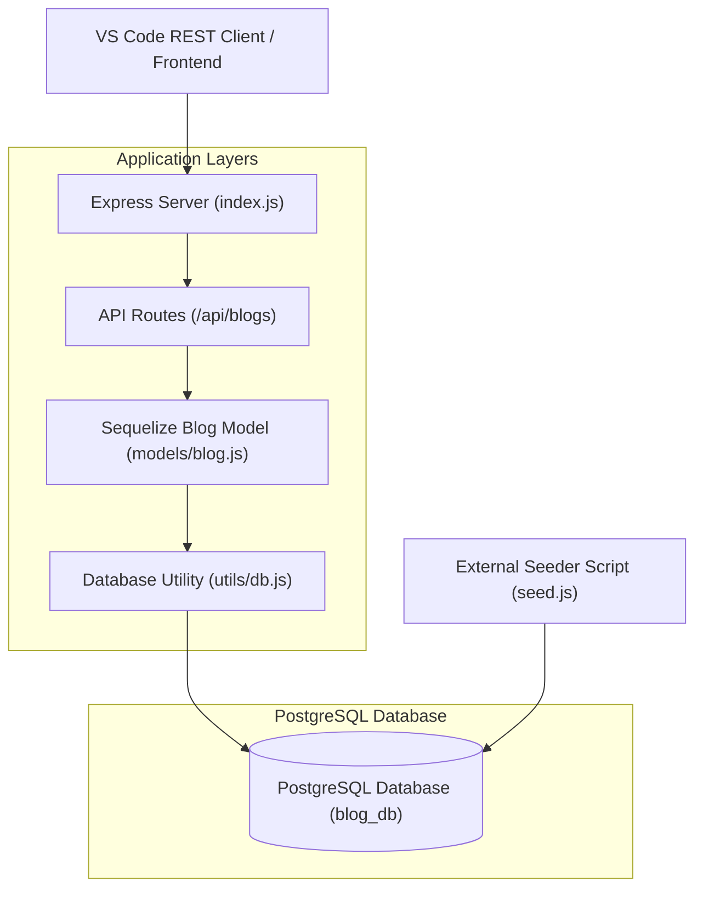

# FullStackOpen-Part-13 

## Blog List Backend Exercise-4

This repository contains a Node.js, Express, and Sequelize backend for a blog service application. The service includes database connection management, automated data seeding, RESTful API development (`GET`, `POST`, `DELETE`), input validation handling, and a local testing workflow using VSCode's RESTClient.

### Architectural Overview & Modular Design

The application follows a modular design pattern to ensure separation of concerns, readability, and maintainability:



The project is organized into structured directories and files:

- `requests.rest`: A modular script configured with file variables for testing API endpoints directly inside VS Code.
- `index.js`: The main entry point initialising the Express application, middleware (`express.json()`), route handlers, and asynchronous startup sequence.
- `models/blog.js`: Defines the Sequelize Blog schema mapping directly to the PostgreSQL table (`id`, `author`, `url`, `title`, `likes`).
- `utils/db.js`: Encapsulates the Sequelize instance and database connection logic.
- `seed.js`: An independent automation script (logic) used to populate the database with initial records.
- `utils/seedingBlogData.js`: Seeding data used to initially populate (seed) the database Blogs table.

### Core API Endpoints

| Method | Endpoint | Description |
| :--- | :--- | :--- |
| **GET** | `/api/blogs` | Retrieves all blog objects stored in the database. |
| **POST** | `/api/blogs` | Creates a new blog entry (validates payload, returns `201 Created` or `400 Bad Request`). |
| **DELETE** | `/api/blogs/:id` | Removes a specific blog by its primary key ID (`204 No Content` or `404 Not Found`). |

### Quick Start Guide

#### Prerequisites

- Node.js (v18+) installed.
- PostgreSQL running locally.
- VS Code with the REST Client extension.

#### Running and Managing the Backend

**Install dependencies:**

   ```bash
   npm install
   ```

**Seed the database (Populate initial data):**

   ```bash
   npm run seed
   ```

**Start the application:**

   ```bash
   npm start
   ```

**Testing the Endpoints:**

   Open the `requests.rest` file in VS Code and click **Send Request** above any of the defined blocks to interact with our running API (`http://localhost:3001/api/blogs`).

- **Note:** I thought I had done a good job with Exercise 4, going above and beyond to create a robust structure with clean, efficient, readable and maintainable code. However, Chapter 3 challenged that assumption and made me realise there was considerable room for improvement. Consequently, the README needs to be rewritten to reflect the improved structure, design and coding practices.

---


## Blog List Backend Exercise-5

This repository contains a Node.js, Express, and Sequelize backend for a blog service application, refactored into a professional, modular **MVC (Model-View-Controller)** architecture. The service includes centralized configuration, database connection management, automated data seeding, custom middleware, robust error handling, and a local testing workflow using VS Code's REST Client.

### Architectural Overview & Modular Design

The application follows a clean modular design pattern to ensure strict separation of concerns, scalability, and maintainability:


The project is organized into structured directories and files:

- `requests.rest`: A modular script configured for testing API endpoints (including success, validation failures, 404s, and malformed IDs) directly inside VS Code.
- `index.js`: The main application entry point initializing Express, mounting middleware (`express.json()`), connecting routers, and managing the asynchronous startup sequence.
- `utils/config.js`: Centralizes environment variables (such as `PORT` and `DATABASE_URL`).
- `utils/db.js`: Encapsulates the Sequelize instance and database connection logic with explicit authentication.
- `models/blog.js`: Defines the Sequelize Blog schema mapping directly to the PostgreSQL table (`id`, `author`, `url`, `title`, `likes`).
- `models/index.js`: Centralized export portal for all database models.
- `controllers/blogs.js`: Houses route handlers (`GET`, `POST`, `DELETE`) and the custom `blogFinder` middleware for encapsulating resource lookups and error handling.
- `seed.js`: An independent automation script used to reset, drop, and populate the database with initial records.
- `utils/seedingBlogData.js`: Seeding data payload used to initially populate the blogs table.

### Core API Endpoints & Middleware

| Method | Endpoint | Description |
| :--- | :--- | :--- |
| **GET** | `/api/blogs` | Retrieves all blog objects stored in the database. |
| **POST** | `/api/blogs` | Creates a new blog entry (validates payload, returns `201 Created` or `400 Bad Request`). |
| **DELETE** | `/api/blogs/:id` | Uses `blogFinder` middleware to look up the resource, removes it by primary key ID (`204 No Content`, `404 Not Found`, or `400 Malformed ID`). |

### Quick Start Guide

#### Prerequisites

- Node.js (v18+) installed.
- PostgreSQL running locally.
- VS Code with the REST Client extension.

#### Running and Managing the Backend

**Install dependencies:**

```bash
npm install
```

**Seed the database (Populate initial data):**

```bash
npm run seed
```

**Start the application:**

```bash
npm start
```

**Testing the Endpoints:**

Open the `requests.rest` file in VS Code and click **Send Request** above any of the defined blocks to test success paths, missing fields, non-existent 404 items, and malformed IDs against our running API (`http://localhost:3001/api/blogs`).

## Blog List Backend Exercise-6

That was easy! For a PUT /api/blogs/:id request, the main challenge is to correctly identify the required blog by its id. In that respect, the Blog.findByPk middleware function can do all the heavey lifting for us.

The `blogFinder` already handles:

- Looking up the blog by its ID (`Blog.findByPk`)

- Catching malformed IDs (sending a 400 error)

- Catching missing blogs (sending a 404 error)

- Attaching the found blog to `req.blog`

See the new `PUT` route in `controllers/blogs.js` and the new `PUT` test script in `requests.rest`.