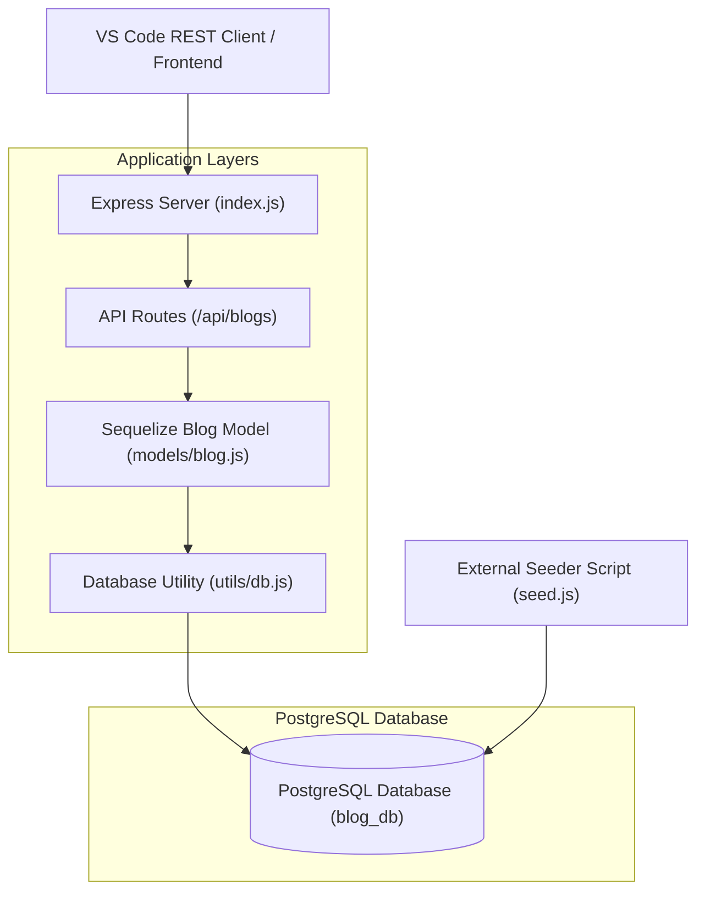

# FullStackOpen-Part-13 - Blog List Backend Exercise-4

This repository contains a Node.js, Express, and Sequelize backend for a blog service application. The service includes database connection management, automated data seeding, RESTful API development (`GET`, `POST`, `DELETE`), input validation handling, and a local testing workflow using VSCode's RESTClient.

## Architectural Overview & Modular Design

The application follows a modular design pattern to ensure separation of concerns, readability, and maintainability:



The project is organized into structured directories and files:

- `requests.rest`: A modular script configured with file variables for testing API endpoints directly inside VS Code.
- `index.js`: The main entry point initialising the Express application, middleware (`express.json()`), route handlers, and asynchronous startup sequence.
- `models/blog.js`: Defines the Sequelize Blog schema mapping directly to the PostgreSQL table (`id`, `author`, `url`, `title`, `likes`).
- `utils/db.js`: Encapsulates the Sequelize instance and database connection logic.
- `seed.js`: An independent automation script (logic) used to populate the database with initial records.
- `utils/seedingBlogData.js`: Seeding data used to initially populate (seed) the database Blogs table.

## Core API Endpoints

| Method | Endpoint | Description |
| :--- | :--- | :--- |
| **GET** | `/api/blogs` | Retrieves all blog objects stored in the database. |
| **POST** | `/api/blogs` | Creates a new blog entry (validates payload, returns `201 Created` or `400 Bad Request`). |
| **DELETE** | `/api/blogs/:id` | Removes a specific blog by its primary key ID (`204 No Content` or `404 Not Found`). |

## Quick Start Guide

### Prerequisites

- Node.js (v18+) installed.
- PostgreSQL running locally.
- VS Code with the REST Client extension.

### Running and Managing the Backend

**Install dependencies:**

   ```bash
   npm install
   ```

**Seed the database (Populate initial data):**

   ```bash
   npm run seed
   ```

**Start the application:**

   ```bash
   npm start
   ```

**Testing the Endpoints:**

   Open the `requests.rest` file in VS Code and click **Send Request** above any of the defined blocks to interact with our running API (`http://localhost:3001/api/blogs`).