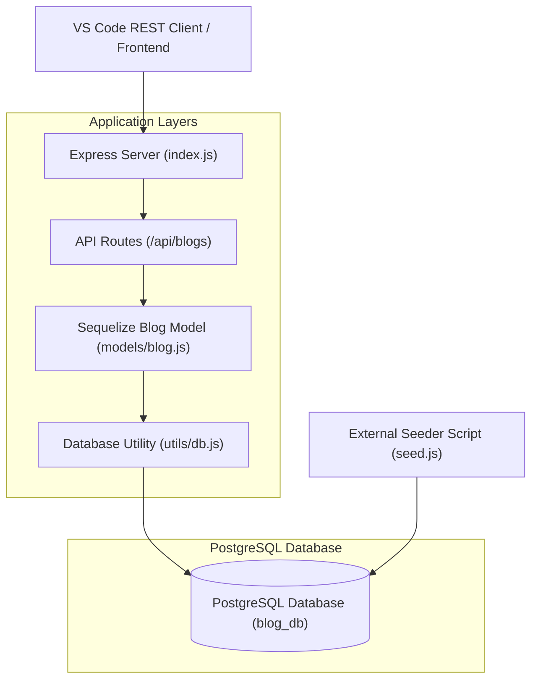
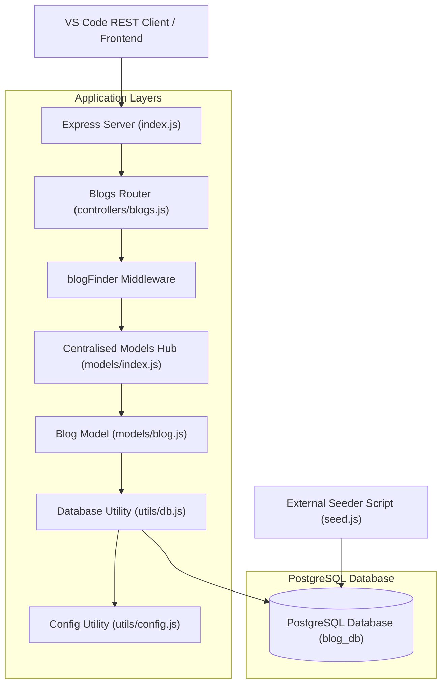
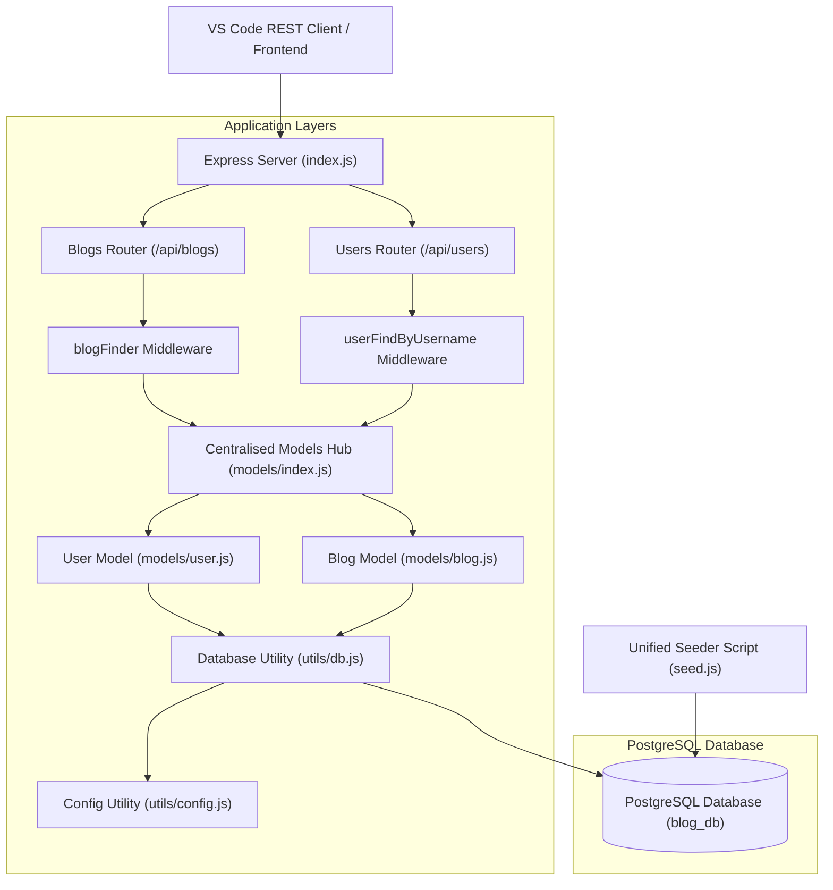
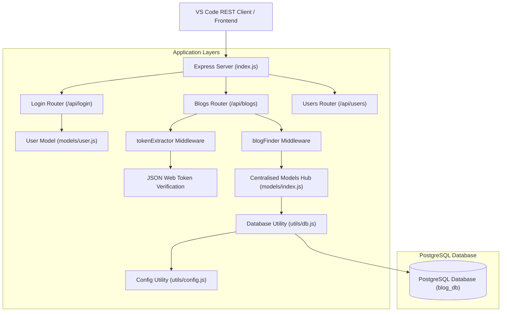

# FullStackOpen-Part-13 

## Blog List Backend Exercise-4

This repository contains a Node.js, Express, and Sequelize backend for a blog service application. The service includes database connection management, automated data seeding, RESTful API development (`GET`, `POST`, `DELETE`), input validation handling, and a local testing workflow using VSCode's RESTClient.

### Architectural Overview & Modular Design

The application follows a modular design pattern to ensure separation of concerns, readability, and maintainability:



The project is organised into structured directories and files:

- `requests.rest`: A modular script configured with file variables for testing API endpoints directly inside VS Code.
- `index.js`: The main entry point initialising the Express application, middleware (`express.json()`), route handlers, and asynchronous startup sequence.
- `models/blog.js`: Defines the Sequelize Blog schema mapping directly to the PostgreSQL table (`id`, `author`, `url`, `title`, `likes`).
- `utils/db.js`: Encapsulates the Sequelize instance and database connection logic.
- `seed.js`: An independent automation script (logic) used to populate the database with initial records.
- `utils/seedingBlogData.js`: Seeding data used to initially populate (seed) the database Blogs table.

### Core API Endpoints

| Method | Endpoint | Description |
| :--- | :--- | :--- |
| **GET** | `/api/blogs` | Retrieves all blog objects stored in the database. |
| **POST** | `/api/blogs` | Creates a new blog entry (validates payload, returns `201 Created` or `400 Bad Request`). |
| **DELETE** | `/api/blogs/:id` | Removes a specific blog by its primary key ID (`204 No Content` or `404 Not Found`). |

### Quick Start Guide

#### Prerequisites

- Node.js (v18+) installed.
- PostgreSQL running locally.
- VS Code with the REST Client extension.

#### Running and Managing the Backend

**Install dependencies:**

   ```bash
   npm install
   ```

**Seed the database (Populate initial data):**

   ```bash
   npm run seed
   ```

**Start the application:**

   ```bash
   npm start
   ```

**Testing the Endpoints:**

   Open the `requests.rest` file in VS Code and click **Send Request** above any of the defined blocks to interact with our running API (`http://localhost:3001/api/blogs`).

- **Note:** I thought I had done a good job with Exercise 4, going above and beyond to create a robust structure with clean, efficient, readable and maintainable code. However, Chapter 3 challenged that assumption and made me realise there was considerable room for improvement. Consequently, the README needs to be rewritten to reflect the improved structure, design and coding practices.

---


## Blog List Backend Exercise-5

This repository contains a Node.js, Express, and Sequelize backend for a blog service application, refactored into a professional, modular **MVC (Model-View-Controller)** architecture. The service includes centralised configuration, database connection management, automated data seeding, custom middleware, robust error handling, and a local testing workflow using VS Code's REST Client.

### Architectural Overview & Modular Design

The application follows a clean modular design pattern to ensure strict separation of concerns, scalability, and maintainability:



The project is organised into structured directories and files:

- `requests.rest`: A modular script configured for testing API endpoints (including success, validation failures, 404s, and malformed IDs) directly inside VS Code.
- `index.js`: The main application entry point initialising Express, mounting middleware (`express.json()`), connecting routers, and managing the asynchronous startup sequence.
- `utils/config.js`: Centralises environment variables (such as `PORT` and `DATABASE_URL`).
- `utils/db.js`: Encapsulates the Sequelize instance and database connection logic with explicit authentication.
- `models/blog.js`: Defines the Sequelize Blog schema mapping directly to the PostgreSQL table (`id`, `author`, `url`, `title`, `likes`).
- `models/index.js`: Centralised export portal for all database models.
- `controllers/blogs.js`: Houses route handlers (`GET`, `POST`, `DELETE`) and the custom `blogFinder` middleware for encapsulating resource lookups and error handling.
- `seed.js`: An independent automation script used to reset, drop, and populate the database with initial records.
- `utils/seedingBlogData.js`: Seeding data payload used to initially populate the blogs table.

### Core API Endpoints & Middleware

| Method | Endpoint | Description |
| :--- | :--- | :--- |
| **GET** | `/api/blogs` | Retrieves all blog objects stored in the database. |
| **POST** | `/api/blogs` | Creates a new blog entry (validates payload, returns `201 Created` or `400 Bad Request`). |
| **DELETE** | `/api/blogs/:id` | Uses `blogFinder` middleware to look up the resource, removes it by primary key ID (`204 No Content`, `404 Not Found`, or `400 Malformed ID`). |

### Quick Start Guide

#### Prerequisites

- Node.js (v18+) installed.
- PostgreSQL running locally.
- VS Code with the REST Client extension.

#### Running and Managing the Backend

**Install dependencies:**

```bash
npm install
```

**Seed the database (Populate initial data):**

```bash
npm run seed
```

**Start the application:**

```bash
npm start
```

**Testing the Endpoints:**

Open the `requests.rest` file in VS Code and click **Send Request** above any of the defined blocks to test success paths, missing fields, non-existent 404 items, and malformed IDs against our running API (`http://localhost:3001/api/blogs`).

## Blog List Backend Exercise-6

That was easy! For a PUT /api/blogs/:id request, the main challenge is to correctly identify the required blog by its id. In that respect, the Blog.findByPk middleware function can do all the heavey lifting for us.

The `blogFinder` already handles:

- Looking up the blog by its ID (`Blog.findByPk`)

- Catching malformed IDs (sending a 400 error)

- Catching missing blogs (sending a 404 error)

- Attaching the found blog to `req.blog`

See the new `PUT` route in `controllers/blogs.js` and the new `PUT` test script in `requests.rest`.


## Blog List Backend Exercise-7

In Exercise-6 our route handlers (like `POST` and `PUT`) used individual `try/catch` blocks to catch database errors and send a `400` response.

Exercise-7 calls for centralised error handling, where we:

- Remove the repetitive `try/catch` blocks from the controllers.

- Pass any errors down to Express automatically using `next(error)`.

- Create a single, dedicated error-handling middleware function at the very end of our application pipeline that catches these errors and decides how to respond to the client.

Files updated:
- **`utils/middleware.js`**: Created the 4-argument `errorHandler` function.

- **`index.js`**: Registered the error handler at the end of the middleware pipeline.

- **`controllers/blogs.js`**: Removed `try/catch` blocks and passed errors via `next(error)`.

---

## Blog List Backend Exercise-8

The repository has been extended to implement a full user management subsystem for the blog service. Exercise-8 introduces a dedicated `User` model, modular user routing (`controllers/users.js`), custom middleware for lookup by unique username, robust password field handling, and local `404` fallback handling for missing records. I added a unified data seeding script, seeding data for users and blogs, and a `requests.rest` REST Client test file.

### Architectural Overview & Modular Design

The application maintains strict modularity, separating user logic from blog logic while leveraging centralised configuration, error handling, and database connection utilities:



The project structure now includes:
- `models/user.js`: Defines the Sequelize User schema mapping to the PostgreSQL `users` table (`id`, `username` [unique, non-nullable], `name` [non-nullable], with Sequelize-managed timestamps via `underscored: true`).
- `controllers/users.js`: Houses route handlers (`GET` all, `POST`, `GET` by ID, `PUT` by username) and the custom `userFindByUsername` middleware.
- `utils/seedingUserData.js`: Seeding data payload for initial users.
- `seed.js`: Updated unified automation script that drops, resets, and seeds both users and blogs sequentially.

### Core User API Endpoints & Middleware

| Method | Endpoint | Description |
| :--- | :--- | :--- |
| **GET** | `/api/users` | Retrieves all user objects stored in the database. |
| **POST** | `/api/users` | Creates a new user entry (validates payload, safely ignores unexpected fields like `password`, returns `201 Created` or `400 Bad Request`). |
| **GET** | `/api/users/:id` | Retrieves a single user by primary key ID (manages missing records locally, returns user or `404 Not Found`). |
| **PUT** | `/api/users/:username` | Uses `userFindByUsername` middleware to look up the user by unique username, updates their name, and saves the instance (`200 OK` or `404 Not Found`). |

### Key Implementation Details

- **Custom Username Middleware (`userFindByUsername`)**: Encapsulates `User.findOne({ where: { username: req.params.username } })` for `PUT` requests, attaching the found user instance to `req.user` or cleanly responding with a `404 Not Found` if no match is found.
- **Password Payload Handling**: Satisfies criteria by accepting requests containing a `password` field during user creation without failing, safely ignoring fields not defined in the Sequelize model schema.
- **Local `404` Fallback**: Recognises that `user == null` lookups in Sequelize represent empty result sets rather than database exceptions, handling them locally as standard `404` errors rather than triggering the centralised error-handling pipeline.
- **Unified Seeding**: Combines user and blog creation into a single sequential script (`seed.js`) to ensure clean state resetting across all database entities.


---

## Blog List Backend Exercise-9

In Exercise-9, we enhanced data validation and API error reporting by implementing built-in email validation on the user model and upgrading our centralised error-handling middleware.

### Key Implementations & Enhancements

* **Model-Level Email Validation (`models/user.js`)**:
  * Configured the `username` field to enforce that values must be valid email addresses using Sequelize's built-in `isEmail` validator.
  * Supplied a custom error message (`"username must be a valid email address"`) to ensure descriptive feedback when validation fails.

* **Upgraded Centralised Error Handling (`utils/middleware.js`)**:
  * Updated the global `errorHandler` middleware to explicitly check for `SequelizeValidationError` instances.
  * Extracted individual validation error messages into an array using `.map()` and returned them in the required structured JSON format (`{ error: ["..."] }`).

### Files Updated
- **`models/user.js`**: Added the `validate` property with the `isEmail` rule and custom error message to the `username` attribute.
- **`utils/middleware.js`**: Added conditional logic to handle `SequelizeValidationError`, mapping errors into a clean array format with an HTTP `400 Bad Request` status code.


## Blog List Backend Exercise-10

The repository has been extended to implement user authentication via JSON Web Tokens (JWT), password verification using `bcrypt`, a dedicated login endpoint (`POST /api/login`), centralised token extraction middleware (`tokenExtractor`), and token-authenticated blog creation (`POST /api/blogs`) linked directly to the user.

### Architectural Overview & Modular Design

The application maintains modularity, separating authentication logic from blog and user management while leveraging centralised configuration, token extraction, model synchronisation, and error handling:



The project structure has been expanded with:
- `utils/authMiddleware.js`: Houses the `tokenExtractor` middleware, which parses incoming `Authorization` headers, strips the `Bearer ` prefix, verifies the cryptographic signature using `jsonwebtoken`, attaches the decoded payload to `req.decodedToken`, and handles missing or invalid tokens with HTTP `401 Unauthorised` responses.
- `controllers/login.js`: Handles user authentication by looking up the user, verifying their password hash using `bcrypt`, and issuing a signed JWT containing their username and database ID.
- `controllers/blogs.js`: Updated to protect the `POST` route with `tokenExtractor`, automatically fetching the user via `User.findByPk` and linking newly created blogs to the authenticated user via foreign keys (`userId`).
- `models/index.js` & `index.js`: Refactored to utilize a modular `syncModels` asynchronous function incorporating Sequelize's `{ alter: true }` lifecycle option during server startup.

### Core Authentication & Blog Creation Endpoints

| Method | Endpoint | Description |
| :--- | :--- | :--- |
| **POST** | `/api/login` | Authenticates user credentials (`username` and `password`), validates password hash, and returns a signed JWT token along with user details (`200 OK` or `401 Unauthorized`). |
| **GET** | `/api/blogs` | Public endpoint retrieving all blog objects stored in the database. |
| **POST** | `/api/blogs` | Protected by `tokenExtractor`. Creates a new blog entry linked to the authenticated user (`201 Created`, `401 Unauthorized`, or `400 Bad Request`). |

### Key Implementation Details

- **Token Extraction (`tokenExtractor`)**: Safely parses incoming `Authorization: Bearer <token>` headers, validating structural integrity while cleanly logging technical errors to the terminal and returning predictable `401` statuses to clients.
- **Secure Password Comparison**: Uses `bcrypt` to securely compare plaintext passwords against database-stored password hashes during login.
- **User Association**: Links each newly created blog to its creator in PostgreSQL via the `userId` foreign key derived from the verified JWT payload.
- **Model Synchronisation (`syncModels`)**: Utilises Sequelize's `sync({ alter: true })` lifecycle hook wrapped in a startup function during server boot to safely align database schemas with updated model definitions.

### Test

Test using the new requestsAuth.rest file which now accommodates authentication through the JWT bearer token.
